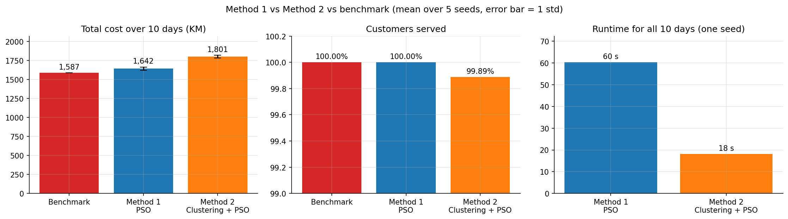
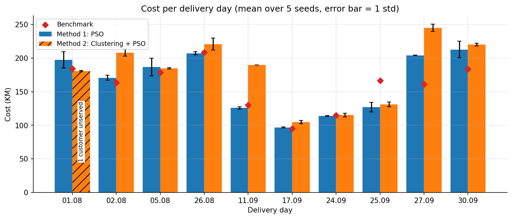
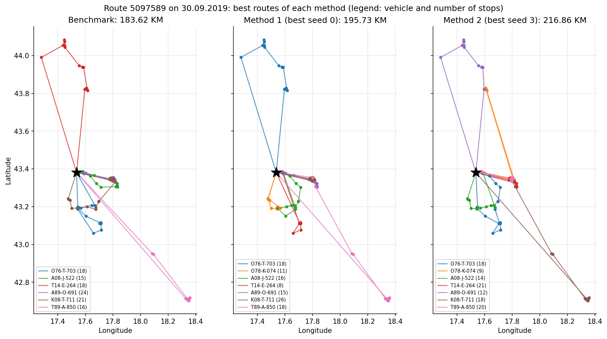
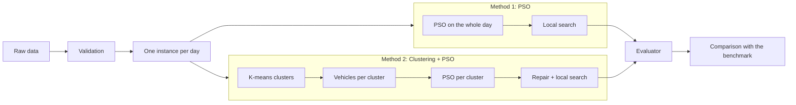

# Vehicle Routing with PSO vs Clustering + PSO


Real-world vehicle routing with time windows, two capacities and site-dependent vehicles, solved in
two ways and compared against the routes published with the dataset:

- **Method 1: PSO.** Particle Swarm Optimization solves each delivery day as one problem.
- **Method 2: Clustering + PSO.** The customers of each day are first split into geographic
  clusters, each cluster gets its own vehicles, and PSO routes every cluster separately.

All code, experiments and figures are in one notebook: [`notebooks/VRP.ipynb`](notebooks/VRP.ipynb).

## Results



| | Method 1: PSO | Method 2: Clustering + PSO | Benchmark |
|---|---|---|---|
| Total cost, 10 days (KM, mean ± std over 5 seeds) | **1,642.38 ± 21.62** | 1,800.76 ± 18.89 | 1,586.59 |
| Gap to the benchmark | **+3.5%** | +13.5% | |
| Total distance (km) | 8,252 | 9,163 | 7,987 |
| Vehicles used (sum over 10 days) | 53.6 | 60.8 | 53 |
| Customer visits served | **100%** | 99.89% | 100% |
| Constraint violations | 0 | 0 | 3 small capacity overloads |
| Days cheaper than the benchmark | **4** | 2 (one of them incomplete) | |
| Runtime, all 10 days, one seed | 60 s | **18 s** | |



**Main findings**

- **Method 1 is the better method.** It stays 3.5% above the published benchmark on average and is
  cheaper than it on 4 of the 10 days, although capacities are strict here while the benchmark
  slightly overloads three vehicles. With the best of the 5 seeds on each day, its total
  (1,588.02 KM) is practically equal to the benchmark.
- **Method 2 is about 3.3 times faster but about 10% more expensive than Method 1.** Each cluster can
  only use its own vehicles, so routes cannot combine customers from different clusters. On
  01.08 it leaves one customer unserved: the only vehicle allowed to serve that customer is used up
  inside its cluster.
- **The difference is statistically significant.** Method 1 is cheaper on 8 of the 10 days; on the
  9 days where Method 2 serves every customer, the Wilcoxon signed-rank test gives p = 0.012.

<details>
<summary>Cost per day (KM, mean over 5 seeds)</summary>

| Route | Date | Benchmark | Method 1 | Method 2 | Method 2 vs Method 1 |
|---|---|---|---|---|---|
| 5084612 | 01.08.2019 | 184.36 | 197.36 | 180.56 (1 customer unserved) | -8.5% |
| 5072926 | 02.08.2019 | 163.53 | 170.65 | 208.27 | +22.0% |
| 5064293 | 05.08.2019 | 178.92 | 186.62 | 184.72 | -1.0% |
| 5052001 | 26.08.2019 | 208.57 | 207.16 | 220.87 | +6.6% |
| 5041384 | 11.09.2019 | 130.12 | 125.97 | 189.81 | +50.7% |
| 5038453 | 17.09.2019 | 95.25 | 96.86 | 104.79 | +8.2% |
| 5092554 | 24.09.2019 | 114.73 | 113.89 | 115.33 | +1.3% |
| 5030001 | 25.09.2019 | 166.72 | 127.03 | 131.18 | +3.3% |
| 5110801 | 27.09.2019 | 160.77 | 204.20 | 245.21 | +20.1% |
| 5097589 | 30.09.2019 | 183.62 | 212.63 | 220.02 | +3.5% |

On 27.09 the benchmark overloads one vehicle by 37 kg. A diagnostic run of Method 1 with a 2%
capacity tolerance reaches 161.60 KM, practically the benchmark's 160.77 KM, so the gap on that day
comes from the strict capacity rule, not from the search.

</details>



## Problem

Every day a distribution company delivers from one depot to 51–112 customers with a fleet of 7–8
vehicles. A solution must respect:

- **time windows**: service must finish before the customer's window closes (waiting is allowed);
- **weight and volume capacity** of every vehicle;
- **site-dependent constraints (SDVRP)**: some vehicles may not serve some customers;
- **working hours** of the vehicles and opening hours of the depot.

The objective is the total cost: distance × cost per km of the vehicle that drives it. Road
distances and travel times are real and asymmetric (A→B differs from B→A).

## Methods



Both methods share the same building blocks, so the only difference between them is the clustering:

| Component | Description |
|---|---|
| Evaluator | Computes cost and checks every constraint. It reproduces the benchmark's costs, arrival times and loads exactly |
| Decoder | Turns a PSO particle (customer and vehicle priorities) into routes by sequential insertion, one vehicle at a time. Every route it builds is feasible |
| PSO | Random-key PSO, 30 particles × 833 iterations (about 25,000 evaluations per run), inertia 0.9 → 0.4 |
| Local search | 2-opt, relocate, swap and vehicle exchange, applied to every personal best after PSO |
| Experiments | 10 days × 5 seeds per method, same seeds and same budget for both methods |

Details: [docs/methodology.md](docs/methodology.md).

## Dataset

The data comes from a large distribution company in Bosnia and Herzegovina: 10 delivery days
(August–September 2019), 896 customer visits (509 different customers), the fleet of each day,
real road distances and travel times (GraphHopper / OpenStreetMap), and the routes produced by the
dataset authors, used here as the benchmark.

> Žunić, Emir (2019): *Real-world VRP benchmark data with realistic constraints - input data and
> results - v2*. 4TU.ResearchData. https://doi.org/10.4121/uuid:6be435d9-c2b4-42e4-a5e2-e683f939b2cb
> (license: CC0)

File descriptions, validation results and data anomalies: [docs/dataset.md](docs/dataset.md).

## Repository structure

```
.
├── README.md
├── requirements.txt
├── data/
│   └── raw/                    original dataset (10 files + readme.txt)
├── notebooks/
│   ├── VRP.ipynb               all code, experiments and figures
│   └── results/
│       ├── method1/            summary.csv, solution.csv, history.csv
│       ├── method2/            summary.csv, solution.csv, history.csv, k_sensitivity.csv
│       ├── comparison/         summary.csv, per_day.csv
│       └── figures/            all figures (PNG)
└── docs/
    ├── dataset.md
    └── methodology.md
```

## How to run

```bash
git clone https://github.com/Anjar425/vrp-pso-clustering.git
cd vrp-pso-clustering
python -m venv .venv
.venv\Scripts\activate          # Windows; on Linux/macOS: source .venv/bin/activate
pip install -r requirements.txt
jupyter notebook notebooks/VRP.ipynb
```

The experiment results are stored in `notebooks/results/`, so the notebook runs in a few minutes
without recomputing them. Set `RUN_EXPERIMENTS = True` (section 9) to rerun all experiments; this
takes about 8 minutes on a laptop.

## Limitations

- Capacities are strict, while the benchmark allows small overloads; this explains most of the gap
  on 27.09.
- The PSO stagnates early, and part of the solution quality comes from the local search.
- Method 2 depends on design choices (number of clusters, vehicle allocation, repair step). Other
  cluster-first designs may perform differently.
- One company, one depot, 10 days; travel times are fixed (no traffic). Route maps draw straight
  lines between stops.

## References

- Žunić, E. (2019). *Real-world VRP benchmark data with realistic constraints - input data and
  results - v2*. 4TU.ResearchData. https://doi.org/10.4121/uuid:6be435d9-c2b4-42e4-a5e2-e683f939b2cb
- Žunić, E., Đonko, D., Buza, E. (2020). *An adaptive data-driven approach to solve real-world
  vehicle routing problems in logistics*. arXiv:2001.02094. https://arxiv.org/abs/2001.02094
- Kennedy, J., Eberhart, R. (1995). Particle swarm optimization. *Proceedings of ICNN'95*.
- Solomon, M. M. (1987). Algorithms for the vehicle routing and scheduling problems with time
  window constraints. *Operations Research*, 35(2), 254–265.

## License

The dataset is published under CC0. The license of the code is still to be added (`LICENSE`).
