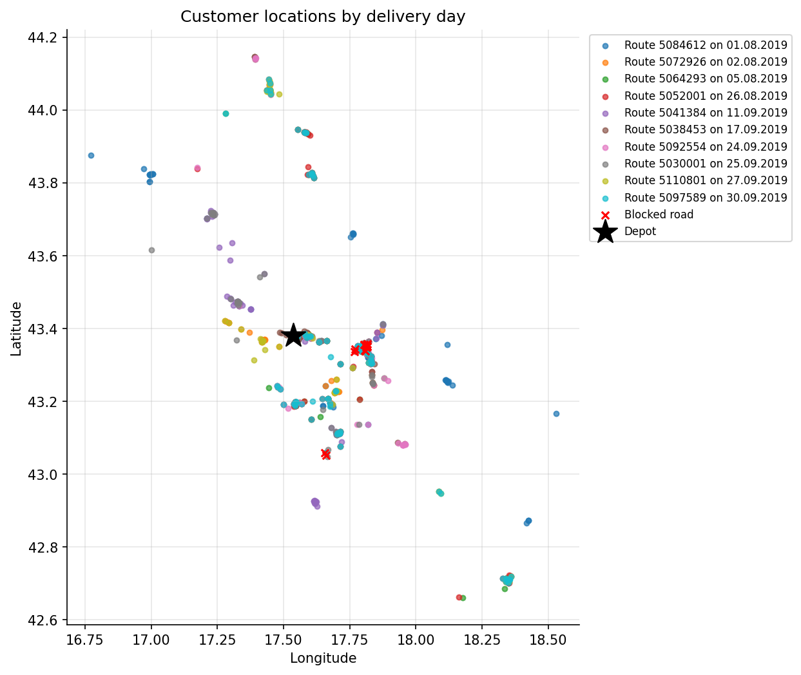
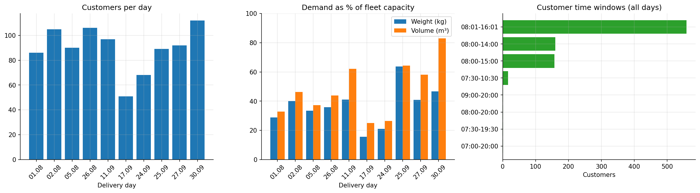

# Dataset

## Source

> Žunić, Emir (2019): *Real-world VRP benchmark data with realistic constraints - input data and
> results - v2*. 4TU.ResearchData. https://doi.org/10.4121/uuid:6be435d9-c2b4-42e4-a5e2-e683f939b2cb

- **License:** CC0 (public domain).
- **Origin:** one of the largest distribution companies in Bosnia and Herzegovina. The routes in the
  dataset were produced by the authors' algorithm in the company's production environment.
- **Distances:** real road distances and travel times, computed with GraphHopper on OpenStreetMap
  while excluding the blocked road sections of file 9.

The original files are kept unchanged in [`data/raw/`](../data/raw/), together with the dataset's
own `readme.txt`. Note that several files have the extension `.xls` and that file 7 is split over
two sheets because of the row limit of the format; the notebook reads every sheet.

## Files

| File | Content | Rows used |
|---|---|---|
| `1_master_table_route_settings.xls` | One row per delivery day (`ROUTE_ID`): date and total cost of the benchmark (`RESULT_TOTAL_COST_KM`) | 10 |
| `2_detail_table_customers.xls` | Customers per day: location, time window, number of articles, weight (kg), volume (m³), service time | 896 |
| `3_detail_table_vehicles.xls` | Fleet per day: weight and volume capacity, fixed and variable cost per km, working hours, benchmark results per vehicle (`RESULT_*`) | 75 |
| `4_detail_table_depots.xls` | Depot location and opening hours (one depot, code 1000) | 10 |
| `5_detail_table_constraints_sdvrp.xls` | Customer–vehicle pairs that are **not allowed** (site-dependent constraint) | 252 |
| `6_detail_table_cust_depots_distances.xls` | Depot → customer and customer → depot distance (km) and travel time (min) | 1,796 |
| `7_detail_table_cust_cust_distances.xls` | Customer → customer distance and travel time, two sheets | 83,748 |
| `8_detail_table_routes_RESULTS.xls` | Benchmark routes: vehicle, stop order, arrival time, cumulative distance | 1,002 |
| `9_table_blocked_parts_of_the_road.xls` | Coordinates of road sections excluded from the distance calculation | 15 |
| `10_REAL_GPS_DATA_A08-J-522_24092019.csv` | GPS log of one vehicle on 24.09.2019 (not used) | 3,295 |

Units: `KM` in a cost column is the convertible mark (currency); `KM` in a distance column is
kilometres; times are minutes after midnight (e.g. 480 = 08:00).

## Delivery days

| Route | Date | Customers | Vehicles | Weight used* | Volume used* | Customers with a specific time window | Benchmark vehicles | Benchmark cost (KM) |
|---|---|---|---|---|---|---|---|---|
| 5084612 | 01.08.2019 | 86 | 7 | 29% | 33% | 29 | 5 | 184.36 |
| 5072926 | 02.08.2019 | 105 | 8 | 40% | 46% | 52 | 6 | 163.53 |
| 5064293 | 05.08.2019 | 90 | 8 | 33% | 37% | 30 | 5 | 178.92 |
| 5052001 | 26.08.2019 | 106 | 8 | 36% | 44% | 33 | 6 | 208.57 |
| 5041384 | 11.09.2019 | 97 | 8 | 41% | 62% | 27 | 6 | 130.12 |
| 5038453 | 17.09.2019 | 51 | 8 | 16% | 25% | 14 | 4 | 95.25 |
| 5092554 | 24.09.2019 | 68 | 7 | 21% | 26% | 27 | 4 | 114.73 |
| 5030001 | 25.09.2019 | 89 | 7 | 64% | 64% | 33 | 5 | 166.72 |
| 5110801 | 27.09.2019 | 92 | 7 | 41% | 58% | 44 | 6 | 160.77 |
| 5097589 | 30.09.2019 | 112 | 7 | 47% | 83% | 48 | 6 | 183.62 |

\* Total demand of the day as a share of the total capacity of the fleet.

**Observations**

- Every `ROUTE_ID` is an independent problem: its own customers, fleet and distance matrix. The same
  customer can appear on several days (896 visits, 509 different customers), so days must not be
  mixed.
- Distances are asymmetric for 86% of the customer pairs (mean difference 0.32 km), and about 1% of
  the node triples violate the triangle inequality.
- **Volume is the tighter capacity**: demand uses up to 83% of the fleet volume but at most 64% of
  its weight.
- The window 08:01–16:01 (481–961 min) is the default (shown as "-" in the benchmark). 38% of the
  visits have a narrower window, the narrowest being 07:30–10:30.
- The fleet is heterogeneous: capacities from about 1,750 to 12,500 kg and costs from 0.19 to 0.51
  per km. Fixed costs are 0, so the cost of a solution is distance × cost per km.

## Validation

The notebook (section 3) runs 16 checks on the raw data. All pass except two warnings:

| Check | Result |
|---|---|
| Same 10 route IDs in every table | PASS |
| Customer and vehicle codes unique within each route | PASS |
| Customer locations identical across routes | PASS |
| Customer → customer matrix complete (n × n per route) | PASS |
| Depot ↔ customer distances complete in both directions | PASS |
| Distances non-negative, zero on the diagonal | PASS |
| SDVRP pairs refer to existing customers and vehicles | PASS |
| Every customer fits in the largest vehicle; total demand within fleet capacity | PASS |
| Benchmark visits every customer exactly once, starts and ends at the depot | PASS |
| Benchmark respects every SDVRP pair | PASS |
| Benchmark cost = Σ (route km × cost per km) = total in the master table | PASS |
| Distance tables contain only known customers | WARN |
| Vehicle cost per km in a plausible range | WARN |

In addition, every customer can be served on its own by at least one vehicle on every day
(capacity, SDVRP, time window and working hours), so a feasible solution exists for each day.

## Anomalies and how they are handled

| Anomaly | Handling |
|---|---|
| `3_detail_table_vehicles.xls` contains 6 stray cells below the table, without `ROUTE_ID` | Dropped when loading, and logged |
| Route 5052001: customer codes 938 and 923635 appear in the distance tables but not in the customer list | Ignored (never looked up) |
| Vehicle `B02-A-000` costs 19.00 per km on 05.08 and 02.08, against 0.19 on 26.08 (most likely a typo) | Kept as given, because the benchmark was computed with the same data and does not use this vehicle on those days |
| The benchmark overloads three vehicles: 7 kg on 01.08, 37 kg on 27.09 (weight) and 0.66 m³ on 30.09 (volume) | Reported. Both methods in this project treat capacity as a strict constraint |

## Time model of the benchmark

The arrival times of all 53 benchmark routes are reproduced exactly (difference 0.0 min) by this
model, which is therefore used to evaluate every solution:

1. A vehicle leaves the depot as late as possible without waiting at its first customer:
   `max(vehicle start, depot opening, window start of the first customer − travel time)`.
2. Arrival at the next stop = end of service at the previous stop + travel time.
3. Service starts at `max(arrival, window start)`; the vehicle waits if it is early.
4. Service always **finishes** before the window closes (closest margin 2.1 min), which is used as
   the hard time-window rule.
5. The vehicle is back at the depot before its working hours end (07:00–18:00) and before the depot
   closes (06:00–18:00).
