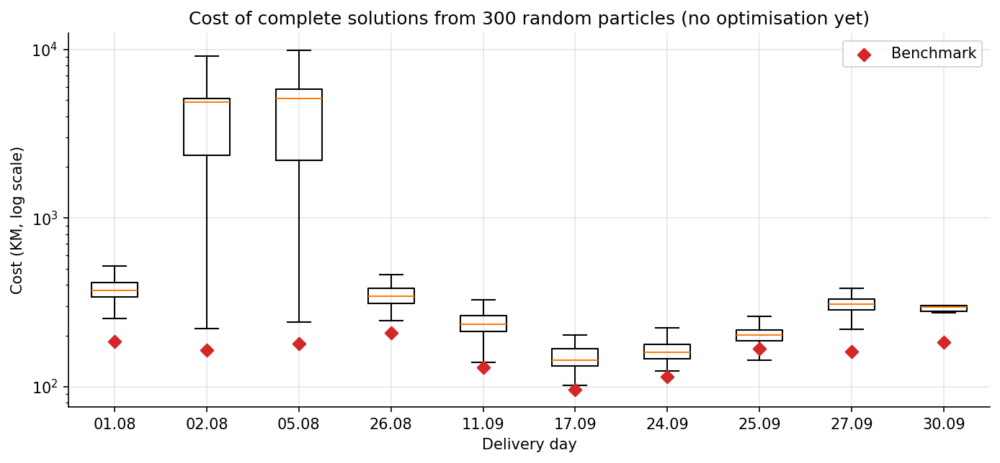
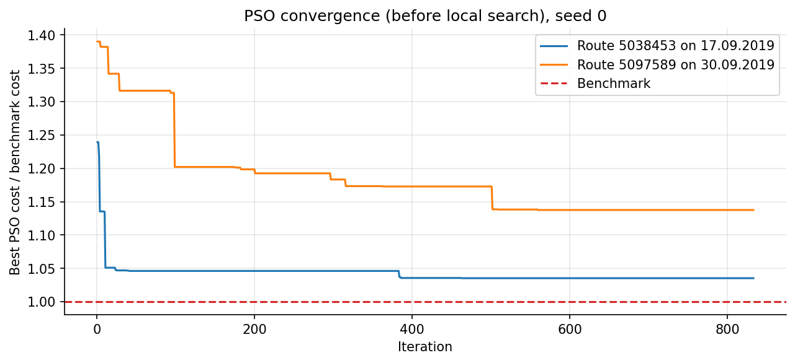
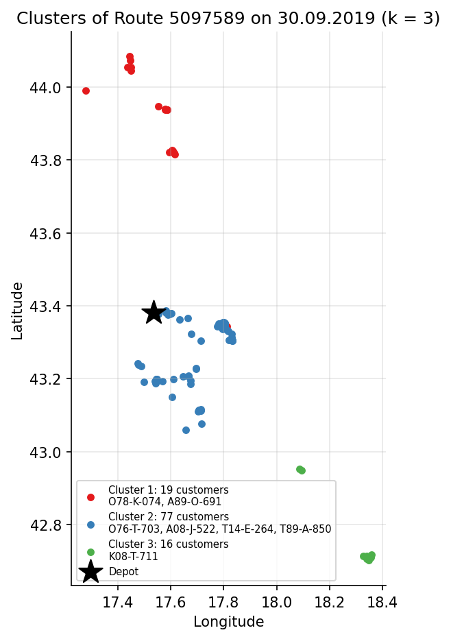
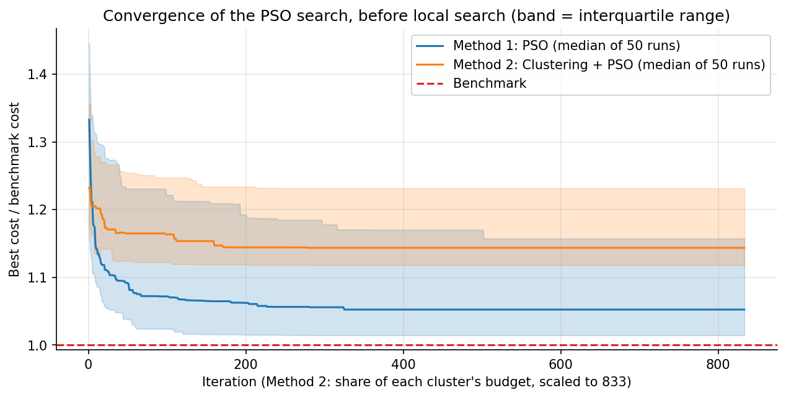

# Methodology

This document describes the model and both methods. The implementation is in
[`notebooks/VRP.ipynb`](../notebooks/VRP.ipynb); section numbers below refer to the notebook.

## 1. Problem (sections 5 and 6)

Each delivery day is an independent instance with one depot (node 0), customers $1..n$ and vehicles
$1..V$.

**Data per instance**

| Symbol | Meaning |
|---|---|
| $d_{ij}$, $t_{ij}$ | Road distance (km) and travel time (min) from node *i* to node *j*; asymmetric |
| $q_i$, $w_i$ | Weight (kg) and volume (m³) delivered to customer *i* |
| $[a_i, b_i]$, $s_i$ | Time window and service time of customer *i* |
| $Q_k$, $W_k$ | Weight and volume capacity of vehicle *k* |
| $c_k$, $f_k$ | Cost per km and fixed cost of vehicle *k* (all fixed costs are 0 in the data) |
| $[e_k, l_k]$ | Working hours of vehicle *k*; the depot is open during $[a_0, b_0]$ |
| $A_{ik}$ | 1 if vehicle *k* may serve customer *i* (site-dependent constraint), else 0 |

**Solution.** A set of routes. Route *r* is driven by vehicle $k(r)$ and visits the sequence
$0, i_1, \dots, i_m, 0$. Every vehicle drives at most one route.

**Objective**

$$\min \sum_r \Big( c_{k(r)} \cdot \text{km}(r) + f_{k(r)} \Big)$$

**Hard constraints**

1. Every customer is visited exactly once.
2. $\sum_{i \in r} q_i \le Q_{k(r)}$ and $\sum_{i \in r} w_i \le W_{k(r)}$.
3. $A_{i\,k(r)} = 1$ for every customer *i* on route *r*.
4. Service starts at $\max(\text{arrival}_i, a_i)$ and finishes by $b_i$: waiting is allowed,
   lateness is not.
5. The vehicle leaves the depot no earlier than $\max(e_k, a_0)$ and returns no later than
   $\min(l_k, b_0)$.

This is a capacitated VRP with time windows, a heterogeneous fleet and site-dependent constraints
(CVRPTW + SDVRP).

## 2. Evaluator (section 6)

A single function computes the cost and checks all constraints for any solution: benchmark,
Method 1 and Method 2. Violations are reported separately (kg and m³ over capacity, minutes late,
minutes of overtime, forbidden visits, unserved customers, duplicate visits, reused vehicles), never
hidden in a penalty.

The time model was reconstructed from the benchmark routes (see [dataset.md](dataset.md#time-model-of-the-benchmark)).
**Validation:** applied to the 53 benchmark routes, the evaluator reproduces the total cost of every
day, every arrival time, and every per-vehicle result in the dataset (cost, driving time, service
time, active time, weight and volume) with a difference of 0. A sanity test confirms that broken
solutions (customer removed, served twice, all customers on one vehicle, forbidden vehicle) are
detected.

## 3. Decoder (section 7)

PSO searches over continuous vectors; the decoder turns such a vector into routes.

**Encoding.** A particle is a vector in $[0,1]^{n+V}$: one key per customer (low key = high priority)
and one key per vehicle (vehicles are opened in increasing key order).

**Sequential insertion (Solomon-style).** Routes are built one vehicle at a time:

1. Open the next vehicle in the vehicle-key order.
2. Seed its route with the highest-priority customer this vehicle may serve.
3. Repeatedly insert the unrouted customer with the lowest score
   $\Delta\text{km} + \alpha \cdot \text{key}_u$ (with $\alpha = 5$) at its best feasible position.
4. Close the route when no customer fits; open the next vehicle.

A position is feasible if the vehicle may serve the customer, has enough weight and volume left,
service finishes inside the customer's window, and every later stop stays on time with the vehicle
back before closing. The check takes constant time per position: each route keeps the earliest finish
time and the latest allowed start time of every stop. Customers that fit nowhere are returned as
*unassigned*; they are never dropped silently.

The decoder is compiled with Numba (0.07–0.26 ms per particle). On 3,000 random particles, every
decoded solution passed the evaluator without a single violation.

**Design note.** A parallel cheapest-insertion decoder (all vehicles open at once) was tried first.
With random keys it left customers unassigned on 6 of the 10 days in every trial, because each vehicle
travelled between distant areas and ran out of working hours. Building routes one vehicle at a time
keeps them compact.

## 4. PSO and local search (section 8)

**Random-key PSO.** For particle *i* with position $x_i$, velocity $v_i$, personal best $p_i$ and
swarm best $g$:

$$v_i \leftarrow w\,v_i + c_1 r_1 \odot (p_i - x_i) + c_2 r_2 \odot (g - x_i), \qquad x_i \leftarrow \mathrm{clip}(x_i + v_i,\ 0,\ 1)$$

| Parameter | Value |
|---|---|
| Particles × iterations | 30 × 833 (about 25,000 fitness evaluations per run) |
| Inertia $w$ | 0.9 → 0.4, linearly decreasing |
| $c_1$, $c_2$ | 1.5, 1.5 |
| Velocity limit | ±0.2 |
| Fitness | $10^6 \times \text{unassigned customers} + \text{cost}$ (lexicographic) |

**Local search.** After PSO, every personal best (and the global best) is decoded and improved by a
first-improvement local search until no move helps. Every accepted move keeps all hard constraints
satisfied.

| Move | Description |
|---|---|
| Insert | Insert an unassigned customer into the cheapest feasible position |
| 2-opt | Reverse a segment of a route |
| Relocate | Move a customer to another position, in the same or another route |
| Swap | Exchange two customers between two routes |
| Vehicle exchange | Give a route to another (used or unused) vehicle, e.g. a cheaper one |

**Tuning.** On 4 representative days × 3 seeds (mean gap of the final cost to the benchmark):

| Configuration | Particles × iterations | Local search on global best only | Local search on all personal bests |
|---|---|---|---|
| A | 50 × 500 | +13.1% | +12.5% |
| B: A with velocity limit 0.5 | 50 × 500 | +13.0% | +11.3% |
| **C (chosen)** | **30 × 833** | **+10.9%** | **+10.9%** |
| D: double budget | 50 × 1000 | +13.8% | +12.7% |
| E: constant $w$ = 0.73, $c_1 = c_2$ = 1.49 | 50 × 500 | +11.9% | +11.4% |

More iterations do not help (D), because the swarm converges early; a smaller swarm that runs longer
(C) works best for the same budget.

## 5. Method 1: PSO (section 9)

Each day is solved as one problem: all customers and all vehicles of the day go into one PSO run,
followed by the local search.

## 6. Method 2: Clustering + PSO (section 10)

| Step | Description |
|---|---|
| 1. Coordinates | Latitude and longitude projected to km around the depot |
| 2. Clustering | K-means with k = 2, 3, 4; the k with the highest silhouette score is kept |
| 3. Vehicles | Each cluster gets vehicles, cheapest per km first, until its weight, volume and estimated working time (service time + short hops between stops, with the trip to and from the depot deducted from each vehicle's day) are covered. Remaining vehicles form a shared reserve |
| 4. SDVRP | A customer that no vehicle of its cluster may serve is moved to the nearest cluster with an allowed vehicle |
| 5. PSO per cluster | Same decoder, PSO and local search as Method 1. The budget of 833 iterations is split over the clusters in proportion to their number of customers |
| 6. Repair | Customers that do not fit in their cluster are inserted into any feasible route of the day, including reserve vehicles |
| 7. Day-level local search | One local search over the merged solution, the same scope as in Method 1 |

**Sensitivity to k (seed 0).** The silhouette score picks the cheapest k on 5 of the 10 days. Even
with the best k of each day chosen in hindsight, the total (1,662.70 KM) stays about 3% above
Method 1 (1,614.56 KM), so the choice of k is not the main reason for the gap.

## 7. Experimental setup (sections 9–11)

- **Runs:** 10 days × 5 seeds (0–4) per method.
- **Fairness:** same instances, evaluator, decoder, PSO settings, local search, seeds and total number
  of fitness evaluations. The clustering time is part of Method 2's runtime.
- **Verification:** every saved solution is rebuilt from `solution.csv` and re-checked by the
  evaluator.
- **Metrics:** total cost (mean ± std over seeds), gap to the benchmark, distance, vehicles used,
  share of customers served, constraint violations, runtime, convergence iteration.
- **Statistical test:** Wilcoxon signed-rank test on the mean cost per day (paired, two-sided), on
  all days and on the days where Method 2 serves every customer.

